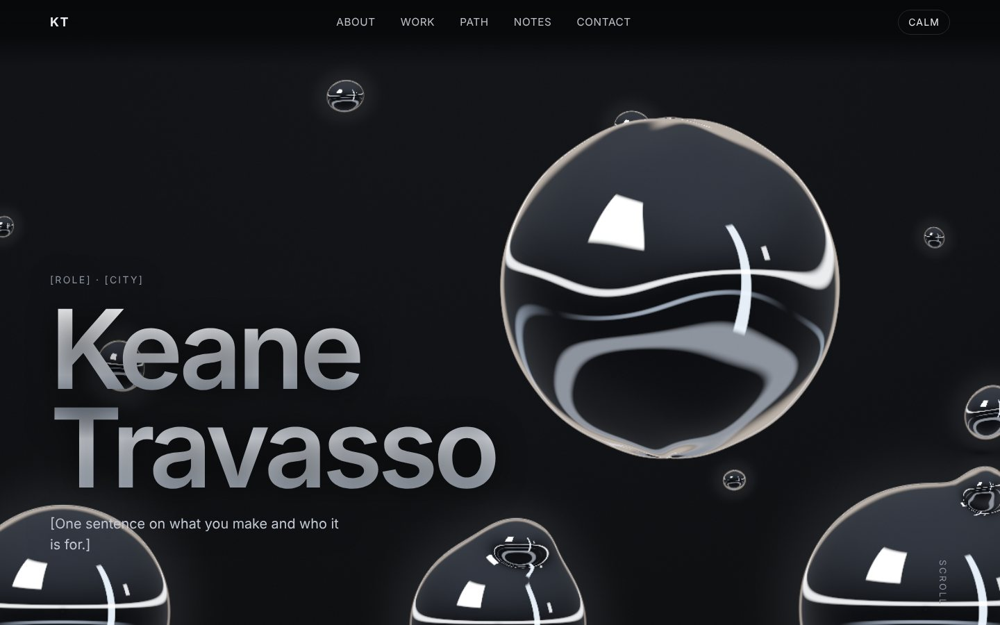

# keanetravasso.com — liquid-metal portfolio (handoff package)

A working first draft plus the full spec for the site. The hard part, the liquid-metal engine, is **already built and tested**. What is left is content, the real head, and polish.



## What is in the box

```
README.md                  you are here
PROMPT_FOR_CHATGPT.md      paste this into ChatGPT (or Codex / Cursor / any coding model) to start
AGENTS.md                  standing rules for any coding agent working in this repo
docs/                      the thinking: vision, screens, engine, scroll, head, plan, deploy, content, perf, honest limits
reference/screens/         screenshots of the current draft (desktop + mobile), the visual baseline
site/                      the code. Vanilla ES modules + WebGL2, Vite build, no framework
```

## Run it

```bash
cd site
npm install
npm run dev          # http://localhost:5173
npm test             # 13 unit tests on the simulation + layouts (node:test, no browser)
npm run build        # -> dist/
npm run shots        # headless Chrome: screenshots of every section, fails on shader/console errors
npm run shots -- --mobile
npm run deploy       # Cloudflare Workers static assets (see docs/07)
```

Needs Node 20+. `npm run shots` needs Chrome/Chromium (set `CHROME=/path/to/chrome` if it is not on a standard path).

## How the metal works, in one paragraph

A small CPU simulation (`site/src/engine/sim.js`) moves up to 32 blobs: spring-anchored "identity" blobs that chase per-section layouts with deliberate overshoot, free droplets that drip, shear off under the cursor, fall under gravity and merge back with a ripple, and a cursor droplet. Each frame the blob state goes to **one fragment shader** (`shaders.js`) that evaluates a metaball field with an **analytic gradient**, which gives exact sphere-like normals, clean necks where blobs merge, and crisp anti-aliasing from a single pass. A procedural studio environment (hard white strips on black) is what makes it read as chrome rather than grey glass. The head is currently an **orb** (raymarched, with wobble modes and a lean toward the pointer) so the rest can be finished before the real head exists. Details: `docs/03-liquid-metal-engine.md`.

## Where to start

1. Read `docs/10-known-limits-and-honest-critique.md` first. It is short and it will save you time.
2. Then `docs/06-build-plan.md`. It is phased with acceptance criteria. Do the phases in order.
3. Put your real copy in using `docs/08-content-and-fonts.md`. Placeholder text is in `[brackets]` throughout `site/index.html`.

## Status of this draft

| Area | State |
|---|---|
| Liquid sim (springs, cohesion, drips, split, merge, ripples, calm mode) | done, 13 tests |
| Shader (chrome look, AA, orb, ripples, grain) | done, verified in headless Chrome (software GL) |
| 6 scroll layouts + DOM-bound cards + infinite reel | done |
| Calm / reduced-motion, WebGL2 fallback, adaptive resolution | done |
| Secondary pages (case study, résumé, quick view) | stubs |
| Real head | **not started** (orb placeholder, contract in `docs/05`) |
| Real content, fonts, SEO, OG image, analytics | **not started** |
| Verified on a real GPU / real phone | **not done**. Only software GL was available. See `docs/09`. |
